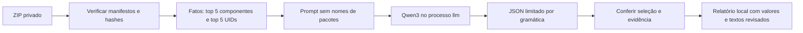

# Leitura local por LLM e debug — AEMA 2.0.1

## Usar no telefone

1. Instale o APK **com modelo** e faça uma coleta completa. As capturas anteriores do
   app também podem ser usadas se tiverem parsing válido e integridade preservada.
2. Abra **Leitura por IA e debug** e toque em **Preparar modelo incluído** uma vez.
   O arquivo é copiado do APK para o armazenamento privado e seu SHA-256 é verificado.
3. Toque em **Ler captura mais recente**. Mantenha a tela aberta; **Cancelar** interrompe
   a operação. A coleta periódica continua com a cadência existente de seis horas.
4. Consulte os pontos selecionados pelo modelo e as sugestões. **Exportar última leitura**
   salva o JSON no local escolhido. **Ver debug** e **Exportar debug JSON** permitem diagnóstico.

O APK menor contém o mesmo runtime, mas exige **Importar Qwen3 GGUF**. Aceita arquivo
GGUF v3 de até 1 GiB; a arquitetura `qwen3` é conferida pela biblioteca ao carregar.
Um cabeçalho aceito na importação não comprova compatibilidade integral dos tensores.
Não são aceitos modelos `.litertlm`, Safetensors ou arquiteturas diferentes de Qwen3.
O app não baixa pesos, não envia dados e não tem permissão `INTERNET`.

O modelo incluído ocupa **639.446.688 bytes**, cerca de 610 MiB. APK e cópia privada
ocupam armazenamento separadamente. Há conferência de espaço na importação. A RAM
necessária depende do sistema e dos aplicativos abertos; o alvo de 6 GB continua
sujeito a teste em aparelhos físicos. O app verifica memória disponível antes da leitura.

## O que foi implementado

Esta versão faz **leitura de um snapshot acumulado**. O LLM seleciona até três pontos
de atenção e sugestões entre fatos permitidos. O app insere nomes, valores em mAh e
textos revisados, depois de validar a seleção. Não há conversa livre, shell gerado
pelo modelo, alteração automática de configurações, fine-tuning pessoal ou previsão
treinada das próximas seis horas. O [estudo](../estudos/README.md) permanece o plano
para essas próximas etapas; não se transforma em resultado validado por esta integração.

Componentes globais e UIDs são classificados em eixos separados. O leitor não soma
CPU/tela com aplicativos; UIDs compartilhados preservam os pacotes associados, sem
repartir arbitrariamente a carga. Estimativas negativas são excluídas e contadas. Um
valor zero não prova ausência de consumo físico. Relações não resolvidas continuam
como UID; o modelo não inventa o nome de um aplicativo.

A captura mais recente é escolhida pela data de modificação do arquivo privado.
Uma captura recente incompleta produz erro, sem recorrer silenciosamente a uma antiga.
Uma leitura anterior permanece salva e identificada pela data e pelo hash da captura.

## Pipeline e limites



- [`aema.llm`](../../src/aema/llm.py) reusa `load_dataset`, modelos e catálogo existentes.
  Não adiciona outro parser BatteryStats. Confere hashes dos artefatos canônicos e dos
  três brutos correspondentes; recusa duplicatas, caminhos inadequados e mais de 128 MiB
  de conteúdo expandido para análise. Não extrai livremente o ZIP para o sistema de arquivos.
- O prompt contém identificadores como `C1` e `A1`, e somente atributos permitidos.
  Nomes de pacotes, serial, payloads, brutos e diagnósticos do parser não entram no prompt.
- A gramática restringe a saída aos IDs de foco. O app deriva ações revisadas de fatos
  positivos selecionados; o modelo não gera texto de ação. A validação recusa campos
  extras, IDs desconhecidos e duplicatas.
  Formato correto não comprova utilidade científica: ainda é necessário avaliar recomendações.
- O runtime roda somente em CPU, quatro threads, contexto 2.048 e máximo de 128 tokens.
  Usa o formato Qwen3 sem raciocínio prolongado. Há limite nativo de 90 s e limite do
  controlador de 120 s incluindo preparação; esses limites não prometem latência de 10 s.
- [`LlmService`](../../android/app/src/main/java/org/aema/capture/LlmService.java) é privado,
  ligado à tela e roda no processo `:llm`. Não recebe acesso Shizuku nem ferramentas.
  Ao encerrar o serviço, seu processo é terminado para liberar recursos ou cargas presas.
  Sair da tela cancela a análise; não se mantém inferência em segundo plano.

## Debug

O catálogo 1.2 acrescenta `gpu_estimated_charge_mah` e `gpu_apps_estimated_charge_mah`.
O parser também reconhece a anotação literal `[energy consumption]` no total global,
observada na captura Android 15. Os números continuam classificados conservadoramente
como atribuições/estimativas; a anotação não fornece uma calibração externa. O AOSP
permite componentes personalizados em [BatteryConsumer](https://android.googlesource.com/platform/frameworks/base/+/refs/heads/main/core/java/android/os/BatteryConsumer.java),
consultado em 24/11/2026. O nome GPU é o rótulo publicado pelo aparelho, não uma
inferência independente sobre seu circuito. Outros nomes desconhecidos continuam
gerando diagnóstico, sem cadastro automático de campos.

Datasets 1.1 existentes continuam importáveis, desde que não reivindiquem as novas
métricas GPU. Um ZIP anteriormente publicado com parsing incompatível continua sendo
um diagnóstico; esta versão não reescreve retroativamente essas capturas.

O histórico privado é limitado aos últimos **40 eventos**. Inclui etapas de importação,
preparação, geração, validação e coleta; códigos de falha; versão/ABI/SDK; RAM total e
disponível; hash e tamanho do modelo; hash da captura; tempos e contagens de tokens.
O estado atual do agendamento também aparece no relatório exportado.

`main_pss_kib` e `worker_pss_after_kib` são amostras instantâneas, não picos.
`worker_peak_rss_kib` vem de `getrusage` no processo nativo e representa o maior RSS
observado naquele processo, não PSS agregado nem energia. Não há medição de overhead
elétrico ou economia de bateria implementada por esses contadores.

O debug não guarda prompt, texto gerado, nomes de pacotes, brutos ou chave HMAC.
Hashes e horários ainda podem correlacionar uma sessão; o debug não é uma exportação
anônima nem substitui o export de estudo por lista de campos permitidos. A exportação
só ocorre quando o usuário escolhe o destino. Limpar debug mantém capturas, modelo
e a última leitura. Provedores de nuvem podem sincronizar o destino por conta própria.

| Situação | Tratamento |
|---|---|
| Sem modelo | Preparar o incluído ou importar Qwen3 GGUF. |
| Sem captura válida | Fazer coleta completa; conferir Shizuku e manifesto. |
| Hash do modelo divergente | Recusar leitura; preparar/importar novamente. |
| Memória insuficiente / processo morto | Mostrar falha; manter última leitura salva. |
| Saída sem evidência | Recusar nova recomendação; registrar `UNGROUNDED_OUTPUT`. |
| Tempo excedido / saída da tela | Cancelar e liberar o serviço; manter dados existentes. |
| Falha de escrita | Informar; capturas e relatório anterior não são apagados pelo leitor. |

## Modelo, licença e reprodução

Foi escolhido o **Qwen3-0.6B Q8_0 oficial**, não um ajuste treinado para bateria.
A variante oficial disponível no repositório consultado é Q8_0; a proposta original
de comparar Q4 continua válida para o benchmark futuro. A escolha desta integração
prioriza origem verificável e demonstração real de inferência, sem declarar Q8 superior.

- [Modelo oficial](https://huggingface.co/Qwen/Qwen3-0.6B-GGUF/tree/23749fefcc72300e3a2ad315e1317431b06b590a).
  SHA-256: `9465e63a22add5354d9bb4b99e90117043c7124007664907259bd16d043bb031`.
- [llama.cpp em revisão fixa](https://github.com/ggml-org/llama.cpp/tree/0ce7f213b0749fa4dee4e87d8ae7bf63e621c1ad).
  O arquivo-fonte é fixado por revisão e hash no CMake, sem consulta a `latest`.
- Licenças e avisos em [THIRD_PARTY_NOTICES](../../THIRD_PARTY_NOTICES.md), também
  acessíveis na tela. As condições dos pesos importados continuam sendo responsabilidade
  de quem escolhe o arquivo.

Requisitos adicionais de build: **NDK 27.2.12479018** e **CMake 3.22.1**. A primeira
configuração baixa o código-fonte fixado; a execução no telefone continua offline.

```powershell
android\gradlew.bat -p android assembleDebug testDebugUnitTest lintDebug
# APK com o modelo oficial, previamente baixado e conferido:
android\gradlew.bat -p android assembleRelease "-PaemaModel=E:\caminho\Qwen3-0.6B-Q8_0.gguf"
```

A chave de assinatura continua fora do Git. O parâmetro `aemaModel` inclui pesos como
asset de release; nenhuma credencial entra no APK. Sem o parâmetro, a build remove o
asset gerado anterior e produz o APK menor. Os pesos não são versionados no Git.

Os testes nativos opcionais usam um modelo real fornecido pelo operador:

```powershell
adb push Qwen3-0.6B-Q8_0.gguf /data/local/tmp/aema-qwen.gguf
android\gradlew.bat -p android connectedDebugAndroidTest "-Pandroid.testInstrumentationRunnerArguments.class=org.aema.capture.LlmFlowTest"
```

Sem o arquivo/instalação adequada, esses testes ficam ignorados, não aprovados por
simulação. Resultados efetivamente executados são registrados nas
[notas de release](../releases/2.0.1.md). Teste em emulador não comprova energia,
compatibilidade com o S25 Plus ou precisão de previsão.
