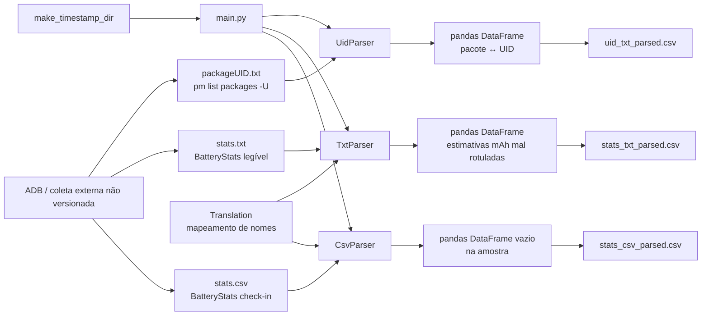
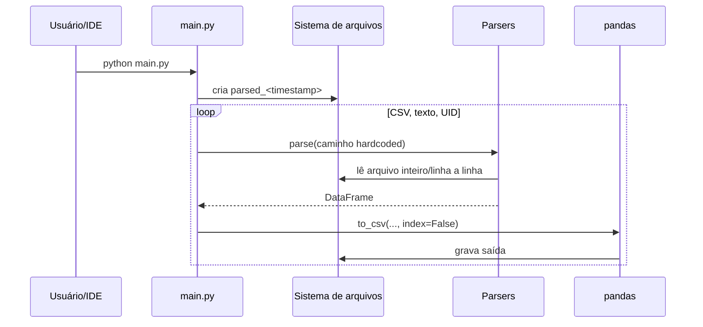

# 03 — Arquitetura

## Visão atual

Trata-se de um script batch monoprocesso, host-side, sem módulos Android. As classes não mantêm estado além do caminho de entrada. Pandas é a única dependência de terceiros observada.

**Propósito do diagrama:** mostrar a topologia observada e os três fluxos que nunca são integrados. **Fontes:** imports e chamadas em [`main.py`, linhas 1–34](../../main.py), parsers citados acima. **Renderização:** este arquivo Mermaid.

## Sequência de execução

**Propósito do diagrama:** explicitar ordenação e risco de saída parcial. Se o segundo parser falhar, o primeiro arquivo já foi gravado; não existe transação, manifesto ou rollback.

## Responsabilidades e dependências

| Componente | Responsabilidade real | Acoplamento/problema |
|---|---|---|
| `main` | Coordenação e nomes | Acoplado ao diretório corrente, nomes fixos e três formatos |
| `CsvParser` | Reconhecimento posicional check-in | Acoplado a schema implícito incompatível; mistura entidades heterogêneas |
| `TxtParser` | Busca textual e tokenização | Acoplado ao inglês e à apresentação humana do dump |
| `UidParser` | Parser de duas chaves | Simples; descarta silenciosamente linhas inválidas |
| `Translation` | Aliases de cabeçalho | Mistura normalização com semântica/unidade incorreta |
| `utils` | Nomeação de pasta | Relógio local sem timezone/UUID/manifesto |

Não foram observadas dependências circulares. A coesão interna é razoável por arquivo, mas a separação mascara um problema de domínio: não existe um modelo de dados comum para sessão, métrica, unidade, escopo, UID, componente e método de medição.

## Fluxo de dados e perdas

1. A aquisição ocorre fora do projeto; comandos, horário, serial, modelo, build e estado experimental não são registrados.
2. `stats.csv` possui colunas `versão, UID, categoria, tag, ...`; `CsvParser` desloca o schema e perde tudo.
3. `stats.txt` contém tanto tempos quanto estimativas em mAh. `TxtParser` seleciona o bloco energético, mas renomeia parte dos valores como tempo.
4. O regex remove qualquer caractere que não seja dígito ou ponto ([`txt_parser.py`, linha 76](../../txt_parser.py)); sinais, expoentes e unidades são destruídos.
5. Cada resultado é uma tabela independente. Nenhum identificador de sessão ou hash de entrada segue para as saídas.

## Arquitetura que deve preceder qualquer implementação futura

**Proposta, não implementada.** Separar aquisição, adaptadores versionados de formato, modelo canônico tipado, validação, análise e exportação. O modelo mínimo deve carregar `session_id`, timestamps monotônico e civil, dispositivo/build, fonte, métrica, valor, unidade, escopo, UID/componente, método (`medido`, `estimado`, `proxy`) e incerteza conhecida. Essa direção aparece no roadmap; não autoriza refatoração nesta auditoria.
