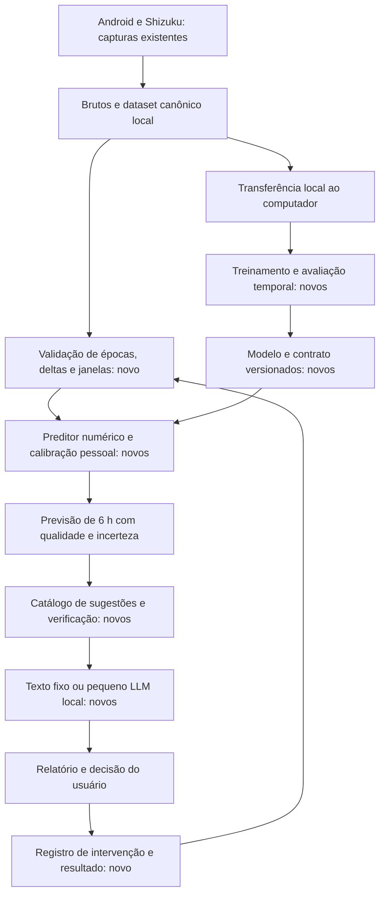

# 4. Arquitetura e plano experimental

[Índice](README.md) · [Dados e validação](03-DADOS-TREINAMENTO-E-VALIDACAO.md) · [Fontes](FONTES.md)

**Desenho proposto em 24/11/2026.** O diagrama apresenta a evolução pretendida, não
componentes já entregues. O app 1.0.0 continua sendo um coletor/parser offline.

## Fluxo proposto

O computador não precisa funcionar como servidor. Após importar um artefato completo,
o telefone produz previsões sem conexão. Importação inicial dos pesos e termos de uso
é uma etapa de instalação; não supor downloads pelo AEMA, que hoje não pede internet.
As [referências de runtime](02-MODELOS-E-EXECUCAO-LOCAL.md) fundamentam a viabilidade de
inferência local, não certificam esta arquitetura ainda não implementada.

## Separação de responsabilidades

| Módulo proposto | Entrada / saída | Invariante |
|---|---|---|
| Gerador de janelas | Capturas verificadas / atributos e rótulos com proveniência | Não compara épocas incompatíveis nem usa futuro como atributo. |
| Preditor | Histórico até a origem / carga, rankings e incerteza por eixo | Identifica método, horizonte, versão e validade. |
| Política de sugestões | Previsão, limitações e catálogo / ações candidatas | Não atribui economia causal sem evidência correspondente. |
| Explicador | Fatos permitidos / texto ou seleção de ação | Não altera previsão nem cria comandos shell. |
| Avaliador pessoal | Previsão registrada e resultado maduro / erro e candidato | Avalia antes de aprender; mantém reversão. |

Não fornecer o binder privilegiado do Shizuku ao LLM. A coleta existente executa comandos
fixos; o módulo de IA deve consumir dados, sem transformar texto em execução privilegiada.
O pedido atual é recomendar modificações. Qualquer futura automação de configurações
exigirá outro escopo, com ações limitadas e controles próprios.

## Contratos dos artefatos a criar

**Pacote numérico:** identificador/versão, família, pesos/árvores, transformações,
lista ordenada de atributos/unidades, ausentes, horizonte, domínios, versões de
coleta/parser, dados de treino, partições, métricas e vetores de equivalência.

**Pacote do explicador:** modelo-base e revisão, origem e licença, tokenizer/template,
adaptador quando houver, quantização, runtime compatível, limites de contexto e
geração, catálogo de ações e casos de aceite. Registrar hashes dos arquivos reais.

**Registro de previsão:** origem e janela-alvo, versão de ambos os modelos, evidências
usadas, qualidade, previsões por eixo, intervalo e razão de abstenção. Depois, adicionar
rótulo observado e erro em um registro vinculado; não reescrever a previsão original.

**Registro de intervenção:** sugestão, aceitação, horário, alteração realmente realizada,
condições, resultado e fatores de confusão. Aceitar sugestão e obter benefício são
eventos diferentes.

Hashes verificam integridade, não autoria. Distribuição a terceiros poderá exigir
autenticação dos pacotes; não declarar que os SHA-256 atuais já oferecem isso.
O app deve rejeitar contrato incompatível e manter modelo vigente ao falhar importação.

## Recomendações fundamentadas

Um relatório poderá dizer: “O modelo prevê maior atribuição ao aplicativo A nesta
janela. Revise sua atividade em segundo plano; restringi-la pode atrasar notificações.”
Só usar o nome A quando sua identidade e atribuição forem resolvidas. Essa frase é um
exemplo de comportamento, não diagnóstico obtido dos dados do autor.

O catálogo candidato inclui brilho/tempo de tela, rede e atividade em segundo plano
quando suportados por evidência observável. Toda ação deve explicar o custo funcional.
Não recomendar encerrar processos indiscriminadamente, desativar proteções ou remover
aplicativos do sistema como resposta padrão. A lista precisa ser revisada por versão
do Android/fabricante; instrução desconhecida resulta em abstenção.

Na apresentação, os valores numéricos podem ser inseridos por código após o texto ser
selecionado, ou conferidos contra os fatos antes da exibição. Isso reduz a dependência
de geração aritmética. Saída JSON válida não garante que a recomendação seja correta.

Para medir economia, alternar condições comparáveis com ordem balanceada, respeitar
períodos de estabilização e repetir os cenários. Uma simples comparação antes/depois
pode refletir mudança de uso, sinal, temperatura ou carga. Só então estimar benefício
líquido, subtraindo coleta e inferência, sem somar parcelas sobrepostas.

## Etapas e condições para avançar

| Etapa | Entrega concreta | Condição de avanço |
|---|---|---|
| 1. Auditoria no S25 Plus | Matriz de campos, resets, APIs e atraso; piloto de overhead | Rótulo escolhido, janelas interpretáveis e perdas conhecidas. |
| 2. Dataset e baselines | Gerador de janelas, contrato e teste temporal B0/B1 | Erros reproduzíveis, sem vazamento; referência claramente identificada. |
| 3. Benchmark local | Modelos pequenos, runtimes e comparação com texto fixo | Vantagem mensurada dentro de memória, tempo e energia. |
| 4. Personalização e sugestões | Modelo vigente/candidato, histórico e ensaios de ações | Melhora futura verificada e sugestões fundamentadas. |
| 5. Compatibilidade | Dispositivos de 6 GB, outro SoC/fabricante e aparelho não visto | Limites de qualidade/custo satisfeitos ou restrição de suporte publicada. |

Não há prazo ou quantidade de exemplos garantidos. A variabilidade observada define
o tamanho dos ensaios; não confundir dias de coleta com quantidade de casos diversos.
O primeiro protótipo não precisa incluir ajuste LoRA, consulta vetorial ou rede neural
complexa. Cada adição deve demonstrar ganho sobre a etapa anterior.

## Reprodutibilidade e privacidade

Usar o [procedimento de pseudonimização](../study/PRIVACY.md) quando houver exportação
para estudo, com contexto por dispositivo. Brutos pessoais ficam locais e fora do Git;
este estudo não os leu nem os publicou. Pesos ajustados e memória pessoal também podem
reter informações; “offline” não significa anonimização. Evitar nomes de pacotes pessoais
no corpus público, nos logs de treino e nas notas de release.

Cada estudo futuro deve guardar protocolo, hashes/versões, divisão temporal, sementes,
dependências, hardware, comandos, falhas e métricas por condição. Não há comando de
treinamento AEMA disponível hoje: criá-lo antes de documentar uma execução real.

## Decisão registrada

Adotar a arquitetura híbrida como **primeira hipótese de implementação**, sujeita à
comparação. Preservar um braço de previsão por LLM para testar a ideia original.
Não escolher definitivamente pesos/runtime nem afirmar precisão antes de coletar e
avaliar dados adequados. A próxima etapa técnica é auditar as capturas do aparelho
e definir um rótulo de seis horas que o coletor consiga sustentar.
