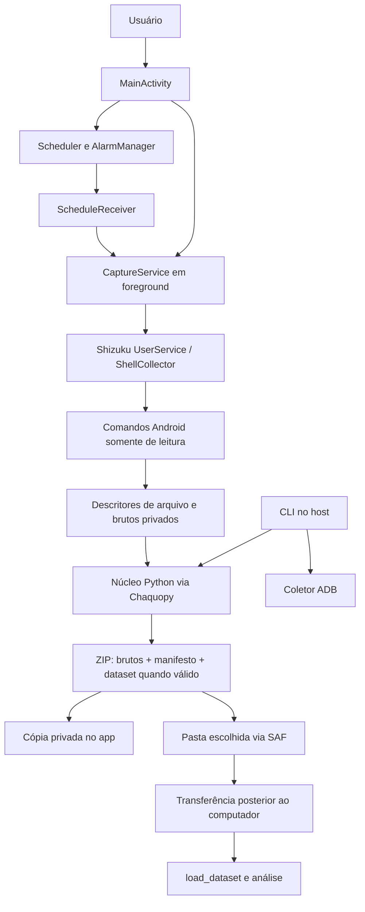

# 3. Arquitetura e tecnologias

[Índice](../README.md) · [Anterior](02-METODOLOGIA.md) · [Próximo](04-CODIGO-E-ALGORITMOS.md)

## 3.1 Visão do sistema

A versão 2.0.0 acrescenta [`AnalysisActivity`](../../android/app/src/main/java/org/aema/capture/AnalysisActivity.java),
o núcleo [`aema.llm`](../../src/aema/llm.py) e um processo nativo privado para Qwen3.
O [guia LLM e debug](../android/LLM-E-DEBUG.md) documenta esse fluxo e seus contratos.
O diagrama abaixo continua descrevendo a cadeia de coleta compartilhada.

O AEMA tem dois pontos de entrada: um app Android para coleta local periódica e uma CLI
no computador para parsing, coleta ADB e análise. Ambos utilizam `src/aema/`. A camada
Android controla permissões, agendamento e arquivos; o núcleo Python interpreta os dados.

A transferência ao computador é uma ação posterior do usuário, não uma conexão de rede
implementada no app. Os módulos de estudo também estão no APK, mas a interface 1.0.0
expõe coleta e parsing automático; a análise científica opera pela CLI/API no host.

## 3.2 Camadas e responsabilidades

| Camada | Implementação | Responsabilidade |
|---|---|---|
| Interface Android | `MainActivity` | Autorizar Shizuku, escolher pasta, habilitar alarmes, iniciar/pausar e exibir estado |
| Agendamento | `IntervalPlan`, `Scheduler`, `ScheduleReceiver` | Cadência, próximo disparo e rearmamento após eventos |
| Orquestração Android | `CaptureService` | Sessão de coleta, foreground, wake lock, metadados, ponte Python e cópia |
| Execução privilegiada | `IShellCollector`, `ShellCollector` | Comandos fixos sob identidade fornecida pelo Shizuku |
| Aquisição host | `collector.py`, `session.py`, `acquisition.py`, `files.py` | ADB, validação de sessão, origem, leitura e hashes |
| Interpretação | `parsers/`, `schemas.py`, `normalization.py` | Parsing versionado e normalização sem persistência |
| Domínio | `models.py`, `catalog.py`, `adapters.py` | Contratos, unidades, classes de evidência e relações |
| Persistência/intercâmbio | `exporters.py`, `dataset.py`, `mobile.py` | Publicação, ZIP e verificação de importação |
| Estudo e privacidade | `validation.py`, `study.py`, `study_export.py`, `privacy.py` | Estatísticas descritivas, auditoria e exports específicos |

## 3.3 Tecnologias e versões da implementação 1.0.0

As versões abaixo vêm dos arquivos de configuração e da build publicada. Não significam
que sejam as versões mais recentes de cada tecnologia.

| Tecnologia | Versão/contrato | Uso e motivo |
|---|---|---|
| Android SDK | minSdk 26; compile/target 35 | APIs de arquivos, serviços e permissões; suporte declarado desde Android 8 |
| Java | Código-fonte Java 17; JDK 21 para build reproduzida | Interface e integração nativas Android |
| Gradle Wrapper | 9.5.1 | Execução de build com distribuição especificada no repositório |
| Android Gradle Plugin | 9.3.0 | Compilação, recursos, AIDL, testes e empacotamento APK |
| Shizuku API/provider | 13.1.5 | Executar leituras autorizadas sob identidade shell/root sem embutir um shell arbitrário |
| AIDL/Binder/PFD | APIs Android | Contrato entre processos e transferência de saídas grandes por arquivo |
| Chaquopy | Plugin 17.2.0; Python 3.13 no APK | Incorporar o mesmo código Python, sem uma segunda implementação dos parsers |
| Python no host | Requisito >=3.10 | CLI, biblioteca, parsing, exportação e análise |
| pandas no host | `>=2.2,<3` | DataFrames e CSVs de compatibilidade |
| pandas no Android | 2.1.3 | Wheel Android configurado explicitamente no build |
| numpy no Android | 1.26.2 observado na build 1.0.0 | Dependência numérica resolvida para o pandas; não é um pin explícito no Gradle |
| setuptools | `>=75` | Build e instalação do pacote Python |
| pytest / pytest-cov | `>=8.3,<9` / `>=5,<7` | Testes Python e cobertura de instruções/branches |
| Ruff | `>=0.8,<1` | Lint e formatação de código Python |
| JUnit | 4.13.2 | Testes JVM da cadência |
| AndroidX Test | Runner 1.6.2; extensão JUnit 1.2.1 | Cenários instrumentados no Android |
| Git / GitHub Actions | Workflow em `.github/workflows/verify.yml` | Histórico, publicação e verificação limpa de Python/Android |
| CSV / JSON / JSONL / ZIP | Contratos locais descritos no capítulo 5 | Inspeção, intercâmbio e transferência offline |
| SHA-256 / HMAC-SHA-256 | Biblioteca padrão Python/Java | Integridade e pseudônimos de estudo, com funções distintas |

Não há backend, banco de dados de aplicação, framework web, treinamento de aprendizado
pessoal, telemetria ou serviço de sincronização implementado. Há inferência de LLM com
pesos gerais, sem ajuste de bateria. SharedPreferences guarda
apenas estado operacional do app; os dados científicos ficam em arquivos.

Em 2.0.0, NDK 27.2.12479018 e CMake 3.22.1 compilam llama.cpp na revisão
`0ce7f213b0749fa4dee4e87d8ae7bf63e621c1ad`. As dependências existentes da tabela
histórica 1.0.0 acima não foram atualizadas. Modelo e hash constam nos
[avisos de terceiros](../../THIRD_PARTY_NOTICES.md).

## 3.4 Reutilização do núcleo Python

`android/app/build.gradle` configura o source set Python para `../../src`. Isso faz o
Chaquopy empacotar diretamente os módulos do host. A política evita divergências de
regex, unidades, normalização e tratamento de falhas entre uma versão Java e outra Python.

Há custo de tamanho do APK, inicialização e dependências nativas. pandas difere entre
host e Android; por isso, testes com a mesma fixture verificam resultados dentro do
APK, em vez de presumir equivalência por compartilhar arquivos. A build inclui ARM64
e x86_64; a execução física ARM64 e páginas de 16 KiB ainda requerem verificação.

`aema.__init__` preserva a API pública com importação tardia. `mobile.publish_capture`
carrega os módulos numéricos apenas quando precisa processar uma coleta completa.
Uma coleta frustrada pode ser empacotada sem inicializar pandas/numpy.

## 3.5 Privilégios e comunicação com Shizuku

O app continua em seu UID Android normal. `ShellCollector` é uma implementação Binder
de `IShellCollector`, iniciada como UserService pelo Shizuku, não um serviço Android
convencional declarado para aceitar intents públicas. Sua identidade é determinada
pelo modo de execução do Shizuku; no teste documentado foi usada a identidade shell.

A interface aceita um número de comando e um descritor de saída. Os comandos vêm de
uma lista fixa, executada com `ProcessBuilder` e argumentos separados. Nenhuma entrada
de texto do usuário é interpolada em shell. stdout vai para o arquivo; uma thread drena
stderr e preserva no máximo 16 KiB de sua mensagem. O comando possui timeout de 120 s.
Saídas grandes não são devolvidas como uma string única no Binder.

A origem arquitetural está no [guia oficial Shizuku](https://github.com/RikkaApps/Shizuku-API).
O app requer instalação/inicialização/autorização do Shizuku; ele não realiza pairing
automático, não importa sessões e não instala serviços de privilégio por conta própria.

## 3.6 Agendamento e ciclo de vida

`Scheduler` usa `AlarmManager.RTC_WAKEUP` e `setExactAndAllowWhileIdle`. A autorização de
alarmes exatos é verificada nas versões que a exigem. A cadência é baseada na âncora UTC
de ativação; alterações do relógio civil podem afetá-la, mesmo havendo timestamps
monotônicos no manifesto. O registro monotônico não transforma o agendador em um relógio
independente de alterações de data/hora.

O receiver rearma o próximo horário e inicia `CaptureService`. O serviço chama
`startForeground`, mantém um wake lock limitado a 20 minutos e realiza a captura em
thread de trabalho. Durante uma coleta já em andamento, novas solicitações ao mesmo
serviço não geram uma segunda execução paralela. O UserService é desvinculado ao terminar.

Após boot ou atualização, somente o alarme é rearmado; não se inicia `dataSync` diretamente
do broadcast de boot. Um horário vencido pode ser tentado dois minutos depois da retomada.
Horários perdidos não são reconstruídos. Para regras gerais das APIs, ver
[alarmes Android](https://developer.android.com/develop/background-work/services/alarms)
e [tipos de foreground service](https://developer.android.com/develop/background-work/services/fgs/service-types).

O retorno do Shizuku via ADB após reboot depende do usuário. Forçar parada, revogar
permissões, desligar o aparelho e restrições do fabricante podem interromper a rotina.
O handler `onTimeout` registra encerramento por limite do Android; não é prova de que
um ZIP tenha sido finalizado antes de uma interrupção abrupta.

## 3.7 Armazenamento e limites de segurança

O diretório privado `files/captures/` mantém o ZIP. A cópia para a pasta SAF ocorre
depois do registro desse arquivo no estado do app. O provedor recebe primeiro um nome
temporário e depois uma tentativa de renomeação. Isso depende das capacidades do provedor;
não há garantia universal de atomicidade ou durabilidade em armazenamento externo.

O manifesto Android não declara permissão de internet. Backup e transferência automática
de dados do app estão desativados nas regras declaradas. Um provedor de nuvem escolhido
no seletor pode sincronizar por iniciativa própria. Não há criptografia adicional de ZIP,
controle de acesso aos arquivos exportados ou exclusão automática por prazo no AEMA 1.0.0.

SHA-256 permite conferir consistência entre arquivos e manifestos. Um atacante que pudesse
reescrever ambos ainda poderia produzir hashes consistentes; não existe assinatura
criptográfica dos dados de captura. A assinatura do APK autentica a distribuição do app,
não cada ensaio coletado.
